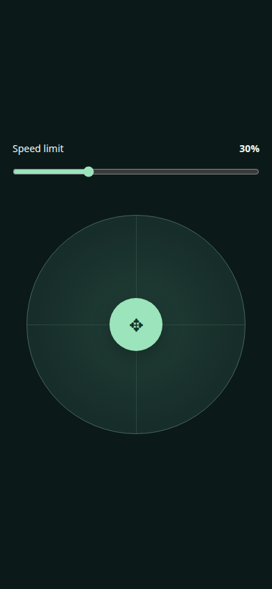
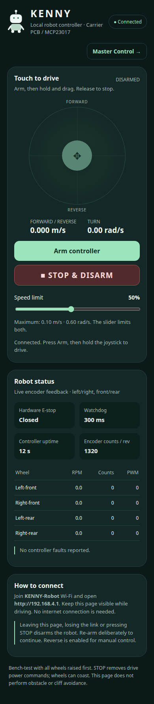

# KENNY ESP32 Wi-Fi Joystick

A phone-browser joystick for a **38-pin ESP32-WROOM**, four JGB37-520 encoder
gearmotors, and two external L298N boards. The ESP32 serves the entire interface
from its own Wi-Fi access point—no phone app, router or internet connection needed.

## Features

- Touch joystick: forward/reverse, turning and in-place rotation.
- Dedicated **Master Control** view showing only a speed slider and joystick.
- Speed-limit slider and STOP/disarm button.
- Four-wheel encoder counts, measured RPM and PWM telemetry.
- Command watchdog, explicit arming, session ownership and E-stop input.
- Independent motor control with direct GPIO or the Kenny MCP23017 carrier.

## Quick start

1. Open **`firmware/kenny_mobile/kenny_mobile.ino`** in Arduino IDE; keep its
   companion headers in the same folder.
2. Install **esp32 by Espressif Systems 3.3.12** and select **ESP32 Dev Module**.
3. Select your actual wiring in **`config.h`**:

   ```cpp
   #define KENNY_WIRING KENNY_DIRECT_GPIO       // Default: earlier direct wiring
   // Or replace that line with:
   #define KENNY_WIRING KENNY_CARRIER_MCP23017  // Carrier PCB, expander directions
   ```

   Choose only one. Direct mode uses E-stop **GPIO15**; carrier mode uses
   **GPIO18**. Their motor-direction connections differ.
4. Upload initially with motor power disconnected. Serial Monitor at **115200**
   shows the selected wiring and network address.
5. On your phone, join **KENNY-Robot**, password **KennyDrive!2026**, then open
   **http://192.168.4.1/**. Stay connected if it reports no internet.
6. For the first powered test, raise all four wheels, verify feedback/polarity,
   press **Arm**, and hold/drag the joystick. Release sends zero; STOP disarms.

The password is a published default; change it in `config.h` before regular use.

**After STOP:** the UI waits for acknowledgement and clears its cached armed
state, so you can arm again. It ignores pre-STOP status replies that arrive late.
If an acknowledgement is lost, a fresh disarmed status can confirm stopping.
When Arm remains disabled, the reason is shown below it: connection, E-stop,
hardware readiness, unconfirmed stopping, or another active session.

## Master Control: speed and joystick only

Select **Master Control →** in the regular interface, or open
**http://192.168.4.1/#master** directly. This view shows only:

- The **0–100% speed slider**.
- The **joystick**.

Touch and hold the joystick to request arming and drive; releasing stops and
disarms. It does not arm on page load or while adjusting the speed slider.
Switching views also stops/disarms and waits for confirmation before accepting
another gesture. Use your browser's Back button to return to diagnostics.
Hardware readiness, connection, E-stop, session ownership and watchdog gates
remain active. A disabled/red joystick indicates an unavailable controller;
return to diagnostics to inspect the reason.

Preview below uses simulated telemetry:



## Wiring and setup

- [Full setup, direct wiring, calibration and troubleshooting](docs/ESP32_MOBILE_CONTROLLER.md)
- [Carrier terminal blocks and MCP23017 mapping](docs/CARRIER_WIRING.md)

Defaults: **±0.10 m/s**, **±0.60 rad/s**, PWM **90/255**, **300 ms watchdog**.
The expected encoder default is **1320 x4 counts/wheel revolution**; verify it
physically. Gains are commissioning starting values, not tuned measurements.

The specified 333 RPM motors have **2.4 A stall current each**, exceeding the
common L298N continuous-channel rating. Resolve driver/current/thermal sizing
before loaded use. Zero PWM may coast; this controller does not avoid obstacles
or cliffs. Carrier sensor pins are reserved, but MPU6050/HX711 readings are not
implemented in this sketch.

## Interface preview

This screenshot uses **simulated telemetry**, not a connected robot:



## Build and verify

After installing Arduino CLI and the ESP32 3.3.12 core:

```bash
python3 scripts/build_mobile_ui.py
arduino-cli compile --fqbn esp32:esp32:esp32 --jobs 2 --warnings all \
  --build-property compiler.cpp.extra_flags=-DKENNY_WIRING=1 firmware/kenny_mobile
arduino-cli compile --fqbn esp32:esp32:esp32 --jobs 2 --warnings all \
  --build-property compiler.cpp.extra_flags=-DKENNY_WIRING=2 firmware/kenny_mobile

g++ -std=c++17 -Wall -Wextra -Werror -fsanitize=address,undefined \
  tests/mobile_control_test.cpp -o /tmp/kenny-mobile-control-test
/tmp/kenny-mobile-control-test
```

Browser checks require a separate Python environment:

```bash
python3 -m venv .test-venv
.test-venv/bin/python -m pip install playwright
.test-venv/bin/python -m playwright install chromium --only-shell
.test-venv/bin/python tests/check_mobile_browser.py
```

Edit **`firmware/kenny_mobile/web/index.html`**, then regenerate `web_ui.h` with
`scripts/build_mobile_ui.py`. No online assets or extra Arduino libraries needed.

Both wiring modes compile. Control checks cover ownership, numeric bounds,
stale/replayed commands, watchdog/counter wrap and 10,000 wheel-limit cases.
Chromium checks cover phone layout, touch drag, release during a pending request,
STOP, blur, rejected commands and E-stop lockout, plus Master Control's two-control
layout, touch-to-arm/release-to-disarm, canceled ARM responses, zero speed and
view-change stopping. Physical radio/motor tests
remain pending until the ESP32 is connected and flashed.
